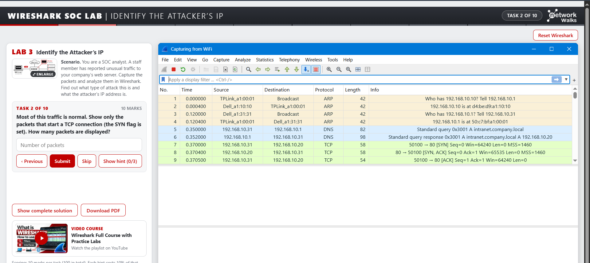

# Lab 3: Identify the Attacker's IP

1. The source IP address is my own IP.
2. The destination belongs to the DNS server.
3. I can confirm my own IP locally with `ipconfig` (`ipconfig /all` on Windows, `ip a` on Linux).
4. There are two TLS handshake filters to know:
   - `tls.handshake.type == 1` is the Client Hello.
   - `tls.handshake.type == 2` is the Server Hello.
5. There are alternative ways of finding the attacker's IP address: Statistics > Conversations, Statistics > Endpoints, or sorting the Source column.
6. Normally the destination IP address is the attacker's target.
7. The server uses RST (reset) to show that a port is closed. Wireshark colours it deep red.
8. A port scan is a type of attack where one IP tries many ports in a very short time to find the open ones.

## Screenshots

