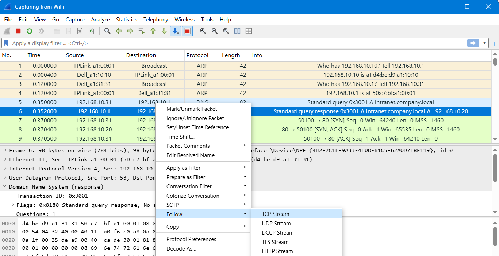

# Lab 4: Follow TCP Stream 1

Goal: read one plain text chat in a capture and see what was shared.

1. Start the capture by double-clicking the interface. The total packet count is the Packets value in the status bar at the bottom.
2. Statistics > Conversations > TCP shows every TCP conversation with its ports. Compare the Port B column with the usual web ports to spot an unusual conversation.
3. Isolate one conversation with `tcp.port == <port>`.
4. The first packet of a TCP connection is a SYN. Its Source column is the computer that started the connection.
5. Right-click a packet that has data (Len above 0) and choose Follow > TCP Stream. Packets with Len 0 carry no content.
6. The Follow window title shows `tcp.stream eq <number>`, which is the stream number.
7. The bottom bar of the Follow window shows the size of the entire conversation in bytes.
8. Each colour in the window is one side of the conversation. The two directions are shown in different colours.
9. Read the messages for who is talking, what they need, and anything sensitive that was shared.

## Screenshots

