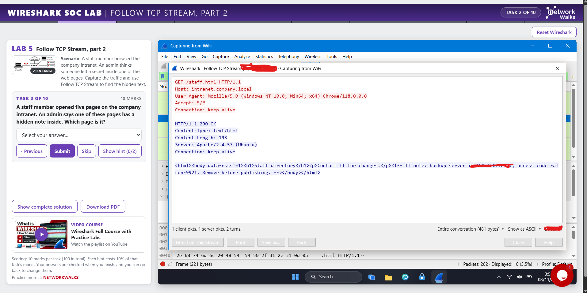

# Lab 5: Follow TCP Stream, Part 2

Goal: find text hidden inside one of several web pages browsed on an intranet.

1. Start the capture and read the packet count from the status bar.
2. Filter the web traffic. Each GET request is one page that was requested.
3. Right-click a GET packet and choose Follow > TCP Stream. Then change the stream number at the bottom of the window to step through the pages one by one.
4. If the stream arrows do not work, close the window and filter with `tcp.stream eq <number>`, then follow a packet from that stream.
5. Look for text that is not part of the normal page. Browsers hide some content that Wireshark still shows.
6. The stream number is shown at the bottom of the Follow window. Use it to record which stream carries which page.
7. Read the hidden text for sensitive details such as codes and server addresses.
8. Colours show who sent the text, so I can tell if it travelled from the client or from the server.
9. The status code is in the first line of the server reply in the stream, or in the HTTP section of the response packet's details.
10. Find downloaded files with `http.request.uri contains "<word>"` and read the end of the GET line.
11. Follow the stream of a downloaded text file to read its content.

## Screenshots

