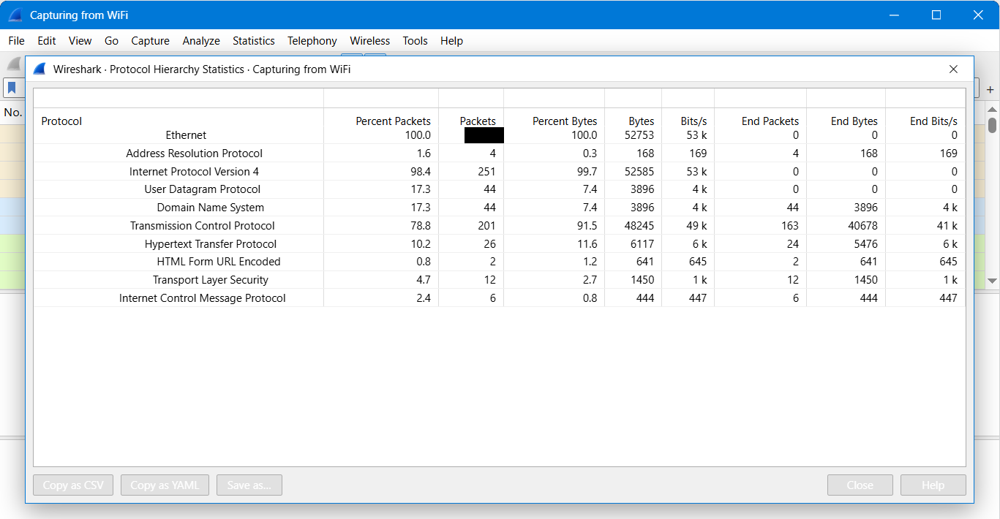

# Lab 6: HTTP Plain Text Credentials

Goal: see what a person can read from a staff portal sign-in that is not encrypted.

1. Start the capture and read the packet count from the status bar.
2. Statistics > Protocol Hierarchy lists the application protocols. Check which one carried the sign-in and whether it is encrypted.
3. A web form sends typed values to the server using a request method. Isolate form submissions with `http.request.method == "<method>"`.
4. The Info column shows the method and the page path the form was sent to.
5. The Source column shows which PC sent the sign-in.
6. The number of packets left after filtering (Displayed in the status bar) is the number of times the form was sent.
7. Click a form packet and scroll to the bottom of the packet details pane. The form section lists the submitted fields in an easy list.
8. To tell a failed attempt from a successful one, compare the attempts in order and read the server response. Follow > TCP Stream shows the response page.
9. Compare a readable sign-in with one that cannot be read to understand what protects the data.

## Screenshots

