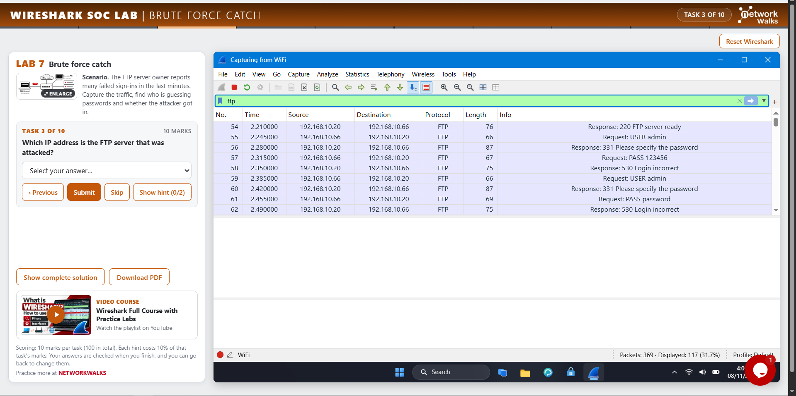

# Lab 7: Catch the Brute Force Attacker

Goal: find who is guessing passwords against a server and whether they got in.

1. Start the capture and read the packet count from the status bar.
2. Statistics > Protocol Hierarchy shows which protocol is in the capture. Look for one that uses login commands.
3. Filter by the protocol name and read the Info column. Requests come from the client and responses come from the server, so the Source of a response is the server.
4. Filter on the password request command. The Source column shows who sent the login attempts.
5. Filter on the username request command and read the Info column to see which account is being targeted.
6. Server replies carry a numeric code. Filter with `<protocol>.response.code == <code>` and read the Info column to learn what each code means.
7. The Displayed value in the status bar counts the failed logins after filtering on the failure code.
8. The successful login stands out as a single reply with a different code from the many failures.
9. Follow > TCP Stream on the successful attempt shows the credentials sent just before the success reply.
10. The pattern to classify: many guesses for one account, then one success.

## Screenshots

