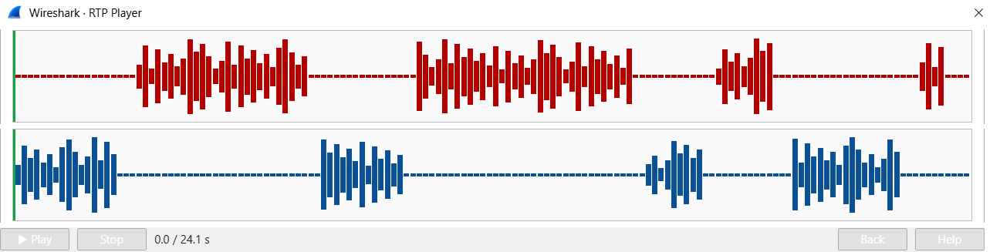

# Lab 8: Catch the Call Scammer

Goal: find a phone call in a capture and play it back to learn what was said.

1. Start the capture and read the packet count from the status bar.
2. Statistics > Protocol Hierarchy helps spot the phone related protocols.
3. Call setup messages appear in the Info column as requests and status messages (INVITE, Ringing, OK). Filter for the INVITE request to isolate the start of the call.
4. In the packet details, open the message header and read the From and To lines to see the extensions and names.
5. The voice itself travels as many small packets sent at regular intervals, separate from the setup messages.
6. Click one voice packet and read the payload type in the packet details to see the codec.
7. To play the call: Telephony > VoIP Calls, select the call, press Play Streams, then press Play. Listen to each side.
8. Listen for who answers and which details are spoken aloud.
9. Think about what a sniffer on the network could do with an unprotected call.

## Screenshots

